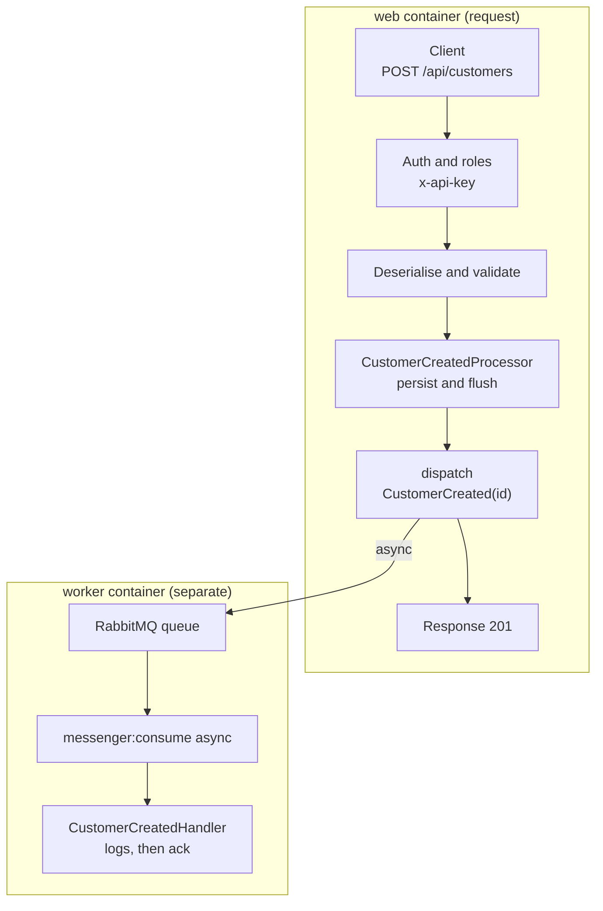

# CCA – Customer Contact API

A prototype REST API for managing customer contacts, built with Symfony 8.1, API Platform 5, Doctrine ORM 3 and MySQL 8, tested with PHPUnit 12. Token authentication, voters, soft delete and an asynchronous Messenger flow with RabbitMQ are part of it.

**History:** The project started in April 2024 as a Symfony 7.0 / API Platform 3 / PHP 8.3 implementation. In 2026 it was upgraded step by step to the current stack, together with Claude Code (Sonnet). The upgrade added Docker, a CI pipeline, voters and an asynchronous Messenger flow with RabbitMQ.

**Why it exists:** It is a practice project for upgrading a real API without losing test coverage, and for working with an AI assistant in small, reviewable steps (see `docs/ai-workflow.md`).

## Quick start (Docker)

PHP 8.4 with FrankenPHP, MySQL 8.0.36 and RabbitMQ 4. Project name `cca`.

```bash
docker compose up -d --build
```

The one-off service `init` installs the Composer dependencies, migrates the dev database and loads the demo data (users, countries, cities, customers). It runs on **every** `docker compose up`, and loading the demo data **replaces all rows** of the dev database. The first start takes a while because of `composer install`.

| Service | Address |
| --- | --- |
| API and API docs | http://localhost:8080/api (HTTPS on 8443) |
| RabbitMQ management UI | http://localhost:15672 (user and password `guest`) |
| MySQL from the host | `127.0.0.1:3307` (user, password and database `cca`) |

The `worker` service runs `php bin/console messenger:consume async` and handles the messages (see [Messenger](#messenger)).

### First request

From the token to the Messenger result, step by step:

1. Open http://localhost:8080/api (Swagger UI).
2. Click **Authorize**, enter the demo token of the admin user `admin@example.com` and confirm:

   ```
   9a1f0c5e7b3d4826a0e1c7f35d8b2a64e91c0d7f3b5a8e2146c9d0f7a3b5e8c1d2f4a6b8c0e2d4f6a8b0c2e4d6f8a0b2c4e6d8f0a2b4c6e8d0f2a4b6c8e0d2f4
   ```

3. Open `GET /api/customers`, click **Try it out** and **Execute**. The demo customers are listed. Without a token the API answers `401`.
4. Open `POST /api/customers`, click **Try it out**, use this body and click **Execute** (`201`):

   ```json
   {"name": "Jane Doe", "email": "jane@example.com", "phone": "0301234567"}
   ```

5. The API has saved the customer and put a `CustomerCreated` message into RabbitMQ. The `worker` takes it and the handler writes a log line:

   ```bash
   docker compose logs -f worker
   ```

6. Optional: the queue `messages` in the RabbitMQ UI (http://localhost:15672, `guest` / `guest`) shows the messages. The worker takes them within milliseconds, so the queue is mostly empty.

The same with `curl`:

```bash
curl -H "x-api-key: 9a1f0c5e7b3d4826a0e1c7f35d8b2a64e91c0d7f3b5a8e2146c9d0f7a3b5e8c1d2f4a6b8c0e2d4f6a8b0c2e4d6f8a0b2c4e6d8f0a2b4c6e8d0f2a4b6c8e0d2f4" -H "Accept: application/ld+json" http://localhost:8080/api/customers
```

The demo tokens come from `src/DataFixtures/UserFixtures.php` and are public. Use them only on a local machine. Further tokens are created with `docker compose exec web php bin/console app:api-token:create <email>` (the token is printed once). The password column is not used (authentication is token-only); `!` is not a valid hash, so no password can match it.

### Docker notes

- The container runs as user ID 1000, so `vendor/` and `var/` belong to the host user. For another host user ID: `UID=$(id -u) GID=$(id -g) docker compose up -d --build`.
- `.env` and `.env.test` are committed with safe defaults only. Put secrets and local overrides in `.env.local`.
- The MySQL init script (`docker/mysql/init.sql`) runs only on the first start. For an existing volume use `docker compose down -v`.

## Authentication and authorisation

Every request needs the header `x-api-key: <token>`. The `ApiTokenAuthenticator` (`src/Security`) looks up the user of the token. Without a valid token the API answers `401`.

Headers for a REST client:

| Header | Value |
| --- | --- |
| `x-api-key` | the token |
| `Accept` | `application/ld+json` |
| `Content-Type` | `application/ld+json` (for `PATCH`: `application/merge-patch+json`) |

| Resource | Path | Operations | Role |
| --- | --- | --- | --- |
| Customer | `/api/customers` | list, get, post, put, patch, delete | `ROLE_USER`; `DELETE` only `ROLE_ADMIN` (voter `CUSTOMER_DELETE`) |
| Address | `/api/addresses` | list, get, post, put, patch, delete | `ROLE_USER` |
| City | `/api/cities` | list, get, post, put, patch, delete | `ROLE_USER` |
| Country | `/api/countries` | list, get, post, put, patch, delete | `ROLE_USER` |
| User | `/api/users` | list, get, post, patch, delete | `ROLE_ADMIN` |
| ApiToken | `/api/api_tokens` | list, get, post, patch, delete | `ROLE_ADMIN` |

Every user also has `ROLE_USER`. The voter (`src/Security/Voter/CustomerVoter.php`) keeps the delete rule in one place instead of in the entity.

## Behaviour of the endpoints

- **Customers** can be filtered and ordered: `?name=`, `?email=` (partial, case-insensitive), `?address.city.name=` (exact) and `?order[name]=asc|desc`.
- **Deleting a customer is a soft delete.** `DELETE` sets `deletedAt`; the row and its addresses stay for traceability. Deleted customers are not listed and answer `404`. The email of a deleted customer stays taken.
- **Deleting a country or city that still has children is refused** with `409 Conflict`; nothing is removed.
- Invalid input answers `422` (validation) with a Hydra error body.
- The unique `email` of a customer is checked by the validator and by a database index.

## Messenger

`POST /api/customers` saves the customer and then sends a `CustomerCreated` message to RabbitMQ. The `worker` service takes it from the queue and calls `CustomerCreatedHandler`, which writes a log line. The request does not wait for that; the handler is a small example for the flow.



- The message is routed with `#[AsMessage('async')]` on the class; the transport `async` is defined in `config/packages/messenger.yaml` and uses `MESSENGER_TRANSPORT_DSN`.
- `src/State/CustomerCreatedProcessor.php` wraps API Platform's persist processor and dispatches the message only after the customer is saved.
- In the `test` environment the transport is `in-memory://`, so tests and CI need no RabbitMQ (the `amqp` PHP extension is still required by `symfony/amqp-messenger`).

## Tests and quality

```bash
docker compose exec web php bin/console --env=test doctrine:database:create       # once
docker compose exec web php bin/console --env=test doctrine:migrations:migrate -n # test database
docker compose exec web php bin/phpunit                                  # all tests
docker compose exec web php bin/phpunit tests/CityTest.php               # one file
docker compose exec web vendor/bin/phpstan analyse --memory-limit=1G     # level 6
docker compose exec web vendor/bin/php-cs-fixer fix --dry-run --diff     # @Symfony code style
docker compose exec web php bin/console doctrine:schema:validate         # entities and migrations match
```

- The functional tests use a real MySQL test database (`cca_test`) and load Liip fixtures. The tests run against the **migrated** schema, so run `--env=test doctrine:migrations:migrate -n` after every new migration.
- A deprecation triggered by this project fails the test run.
- The GitHub Actions workflow (`.github/workflows/ci.yml`) runs PHP CS Fixer, PHPStan, the migrations, `schema:validate` and PHPUnit.

## Known limitations

- **No login and no registration.** An admin creates users, and tokens are created on the server with `app:api-token:create`.
- **Tokens are stored in plain text** in `api_token`. Storing hashes would change the authenticator and the fixtures.
- **No anonymisation yet.** The email of a soft-deleted customer cannot be used again, and `/api/addresses` still shows the addresses of a deleted customer.
- **Messenger has no failure transport.** A message that keeps failing is dropped after the retries.
- **Request logging (dev only).** `LogRequestAndResponseEventListener` writes all request headers (including `x-api-key`) and the full response body to `var/log/request/` (kept for 90 days). Do not use it with real data.

## License

The code of this repository is licensed under the [PolyForm Noncommercial License 1.0.0](LICENSE). In short: you may use it for noncommercial purposes; for commercial use you need a separate license from the author. The full text in `LICENSE` is the only binding version.

The third-party packages installed with Composer (not part of this repository) keep their own licenses. At the time of writing these are MIT (for example Symfony, Copyright (c) Fabien Potencier) and BSD-3-Clause.
